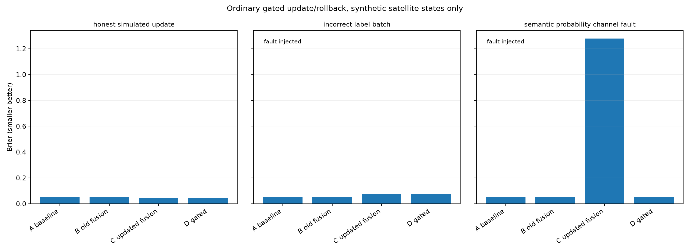
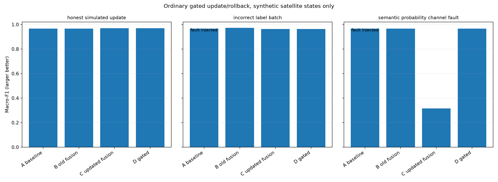

# 严格周期隔离的人工监督更新与模型回退实验分析

**状态：2026-10-24 GitHub Actions 成功，5 项新回退测试、13 项标签质量门控测试全部通过。仅模拟。**

## 一、约束与阶段分区

保持算法主线 **MSF-MOFS → 两级分类器 → HMM 前向滤波 → 异常概率融合 → 健康度评分**。原 MSF 50/10 维（去重59）从原冻结模拟训练 missions0/1 已经得到，本轮不重选特征；真实 OPS-SAT 2,578 维研究的64预算上限（实际选37）仍是另外一个已确定的较好成本—性能工程折中，并不表示“已经应用到本400维模拟任务”。

所有数据来自同一个冻结模拟器，健康/退化/故障、异常和评分均非真实卫星人工真值。本轮只**从零重新拟合状态分类器的校准器**以移除上一轮候选验收周期被用于上游校准的问题，交付冻结版所有文件和模型未修改。

| 分区 | 样本数 | 用途 |
|---|---:|---|
| missions0/1 | 544 | 原MSF选特征、两级分类器训练、HMM状态转移、旧RF历史拟合 |
| mission2 cycle8 | 68 | **新**状态Platt校准和新旧报警阈值估计 |
| mission2 cycle9 | 68 | 新异常RF的模拟人工标注补充批次 |
| mission2 cycle10 | 68 | A与C用**完全相同的**三级状态真值拟合普通融合器 |
| mission2 cycle11 | 68 | 未参与上述任一模型训练/校准的独立候选验收 |
| mission3 cycles12–15 | 272 | 本次独立于训练/验收的描述性审计，不参与决策 |

数据**在本轮拟合、校准、验收和最终审计之间严格隔离**。但 mission3 曾用于旧研究的结果观察，因此不应称为历史上首次未知测试。模拟工况较简单，也不应视为工业/星上部署已验证。

## 二、正确的模拟新增标签：重新校准有益

A=旧异常RF+旧兼容融合；B=普通监督重训异常RF+保留旧融合；C=普通监督重训异常RF+同cycle10重新拟合融合；D=独立cycle11验收后接受C或回退A，**未部署**。

| 方法 | 测试 Macro-F1↑ | Brier↓ | NLL↓ | 异常 Recall↑ | 健康评分MAE↓ |
|---|---:|---:|---:|---:|---:|
| A | 0.9658 | 0.05296 | 0.08839 | 1.0000 | 8.069 |
| B | 0.9658 | 0.05154 | 0.08469 | 1.0000 | 8.075 |
| **C** | **0.9689** | **0.04208** | **0.07220** | **1.0000** | **7.941** |
| D | 0.9689 | 0.04208 | 0.07220 | 1.0000 | 7.941 |

异常Recall已经接近性能天花板，不能依赖单一召回表现判定更新机制优劣。C比B的 Brier 下降约18.4%，但仅为常规融合重训效果，尚非创新机制。

## 三、关键负面实验：错误标签未被验收发现

对 cycle9 的68份模拟二分类标签**故意完全反转**。这是严重标签质量错误的故障注入，不是假设已获真实人类确认的标签。元数据中的“模拟审核”完整性检测不能识别其语义真伪。

**结果：cycle11 上 C 通过了所有预登记的三级状态 F1、Brier、NLL、异常召回、正常误报和评分MAE门控，但 mission3 上却明显恶化：**

| 方法 | 最终 Macro-F1↑ | Brier↓ | NLL↓ | 健康分MAE↓ |
|---|---:|---:|---:|---:|
| A 冻结基线 | 0.9658 | **0.05296** | **0.08839** | **8.069** |
| B 错标签RF+旧融合 | 0.9721 | 0.05219 | 0.08991 | 8.112 |
| C 错标签RF+重拟合融合 | **0.9624** | **0.07239** | **0.11542** | **8.223** |
| D 验收通过C，未能回退 | 0.9624 | 0.07239 | 0.11542 | 8.223 |

**C相对A，Brier恶化约36.7%、NLL恶化约30.6%。** 说明“质量格式门控 + 少量独立验证集的常规性能容差”不足以充分保障语义错误标签的影响。不能为了让实验成功而回头放宽或加严预设阈值。

这一负面结论决定下一阶段研究重点必须包括**输入标签与状态概率证据的语义兼容性**，而不能把标签元数据格式校验当作标签真实性证明。值得研究，但尚未证明一个新的专利机制可以解决它。

## 四、概率类别通道错位：回退确实生效

通过故意将C输出的健康/故障列交换（总体概率向量仍合法）模拟一个错误概率语义映射。

- 错位候选C：最终测试 Macro-F1=0.3165，Brier=1.27793，NLL=8.17130，健康分MAE约61.695。
- cycle11上的验收检测到F1、Brier、NLL和评分MAE不合格，明确拒绝C。
- D沿用A，最终测试F1=0.9658、Brier=0.05296、NLL=0.08839；**已验证内存中回退后三级概率输出逐项精确相同（bitwise一致）**。
- 这是内存候选输出选择；**尚未实现生产环境的原子模型部署/回滚**，不能混淆。

## 五、计算开销与对照含义

同一 GitHub Actions 单线程计时：正确模拟监督数据的RF重训3次中位约**328.9ms**，融合重拟合5次中位约**8.1ms**。负面场景单独计时，完整原始数据特征提取和卫星端实时部署延迟未包括。

结论：(1) 融合重新校准在正确标签场景中有作用；(2) 现有门控能识别大的概率语义通道错误并触发回退；**(3) 现有验收未挡住完全错误的新增二分类标签**，这项能力**尚未跑通**。与此前“所有常规门控均可保证安全更新”的说法不同，本轮明确否定这种过强断言。

## 六、严格边界与后续优先级

1. 依旧只需在同一明确标注数据集研究，跨数据集迁移为论文未来工作。
2. 核心工程研究问题明确为：**新增异常标签是否在当前设备工况、时序三级状态证据与异常证据之间存在无法解释的条件冲突，以及是否应暂缓或拒绝该批更新？**
3. 下一实验必须设置真正不可用的标签批次和正常有效但与既有状态冲突的异常批次；避免硬性将“异常=故障”。已知模拟器中也存在“健康但短暂异常”的真实设计情况，因此不能用简单的二元等式判定错误。
4. 可信人工审核、审计追踪和数据版本权限是前提，但伪造文件元数据不能替代真实专家身份/物理故障确认。
5. 公开研究仓库仅包含常规控制基线及其失败案例；**潜在专利差异化判据、数学机制、权利要求在保密评审前不公开**。现阶段仍不能认定具备专利创造性。
6. 模拟健康评分沿用**默认**状态权重，不是原MVP使用全部mission2评分校准后的2.623 MAE，这两个协议不能混为一谈。

## 七、可复现文件

- 实验前预注册协议：`research/isolated_update_rollback/PROTOCOL_FROZEN.json`
- 全部复现实验脚本：`research/isolated_update_rollback/run.py`
- 回退、分支安全逻辑测试：`research/isolated_update_rollback/test_run.py`
- 全部数字：`results/isolated_update_rollback/metrics.json`
- A/B/C/D 12行对照：`results/isolated_update_rollback/comparison.csv`
- 成功 GitHub Actions：https://github.com/Fan-1-boop/Health-assessment-algorithm-/actions/runs/40086062933 （5+13项测试通过）

交付版本 `release/delivery-mvp-v1.0-frozen` 和主分支 `main` 未修改。
