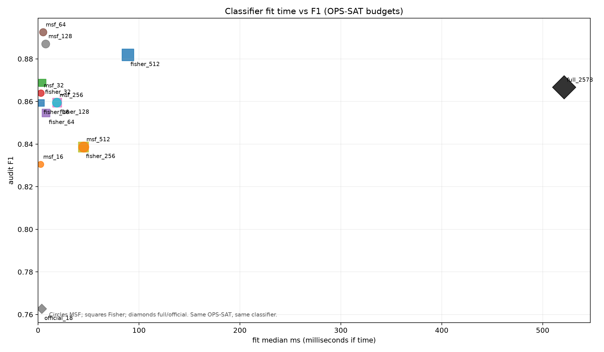
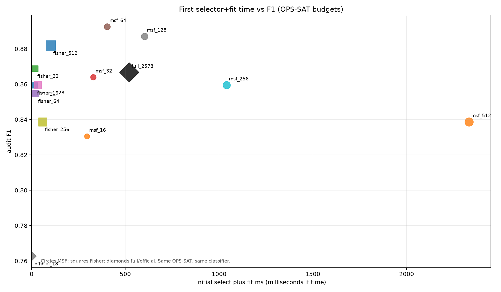
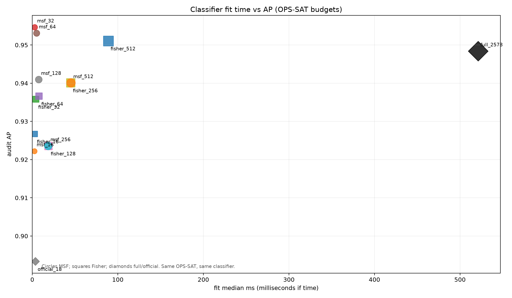
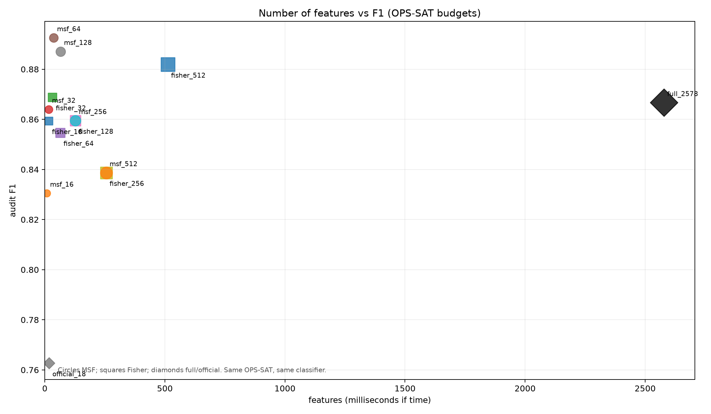

# OPS-SAT 2578 维特征：MSF-MOFS 不同预算的时间—性能平衡

**只使用原官方训练片段；实验属于同一数据集上的探索性对照，之前的多次随机内部审计已被观察，不等同于新独立测试。**

样本数：拟合 956，校准 319，内部审计 319；原官方测试 529 段未使用。
原始遥测派生特征统一提取 5.19 秒，本次预算控制仅决定下游使用哪些维度；不能声称省下全部特征提取时间。

| 方法 | 特征数 | MSF/Fisher选择 ms | 分类器训练 ms | 首次合计 ms | F1 | AP | 异常召回 | 正常误报率 |
|---|---:|---:|---:|---:|---:|---:|---:|---:|
| official_18 | 18 | 0.0 | 3.5 | 3.5 | 0.7627 | 0.8934 | 0.7031 | 0.0353 |
| full_2578 | 2578 | 0.0 | 521.2 | 521.2 | 0.8667 | 0.9484 | 0.8125 | 0.0157 |
| fisher_16 | 16 | 14.2 | 2.7 | 16.9 | 0.8594 | 0.9267 | 0.8594 | 0.0353 |
| msf_16 | 8 | 292.9 | 2.4 | 295.3 | 0.8305 | 0.9222 | 0.7656 | 0.0196 |
| fisher_32 | 32 | 14.2 | 4.2 | 18.4 | 0.8689 | 0.9358 | 0.8281 | 0.0196 |
| msf_32 | 16 | 325.9 | 2.9 | 328.7 | 0.8640 | 0.9547 | 0.8438 | 0.0275 |
| fisher_64 | 64 | 14.2 | 7.9 | 22.1 | 0.8547 | 0.9366 | 0.7812 | 0.0118 |
| msf_64 | 37 | 398.8 | 4.9 | 403.7 | 0.8926 | 0.9531 | 0.8438 | 0.0118 |
| fisher_128 | 128 | 14.2 | 18.8 | 33.0 | 0.8595 | 0.9236 | 0.8125 | 0.0196 |
| msf_128 | 66 | 594.7 | 7.5 | 602.2 | 0.8871 | 0.9409 | 0.8594 | 0.0196 |
| fisher_256 | 256 | 14.2 | 44.7 | 58.9 | 0.8387 | 0.9401 | 0.8125 | 0.0314 |
| msf_256 | 128 | 1021.7 | 18.5 | 1040.2 | 0.8595 | 0.9236 | 0.8125 | 0.0196 |
| fisher_512 | 512 | 14.2 | 88.8 | 103.0 | 0.8819 | 0.9511 | 0.8750 | 0.0275 |
| msf_512 | 256 | 2287.8 | 45.1 | 2333.0 | 0.8387 | 0.9401 | 0.8125 | 0.0314 |

**预先冻结的校准集规则推荐**：official_18；此推荐没有用内部审计指标选择。

这是同一真实卫星数据集上的研究对照，没有跨数据集迁移，也没有真实三级状态真值；MSF 的高压缩和精度之间的代价需如实报告。
