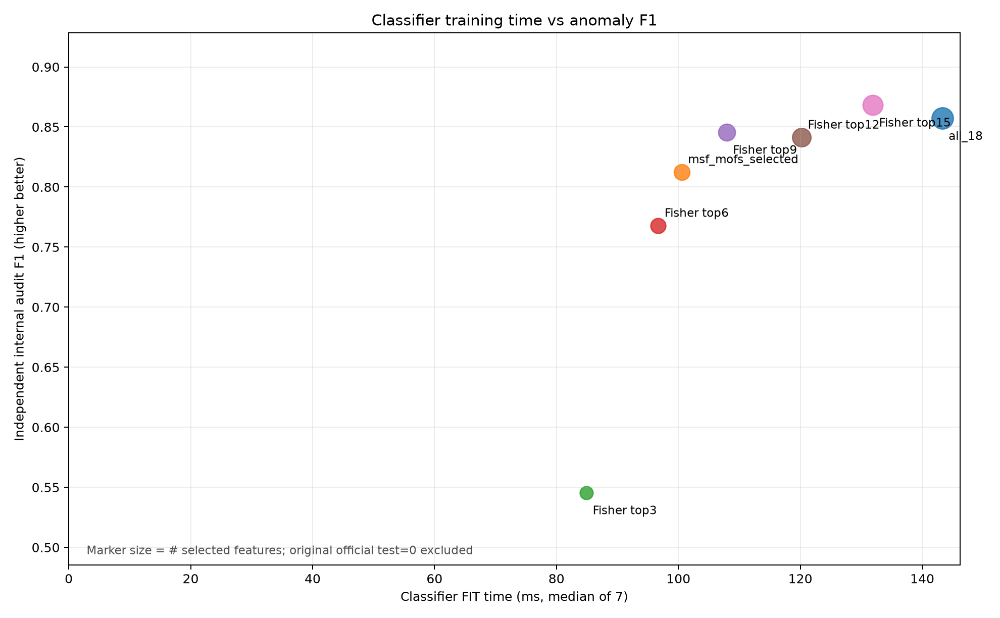
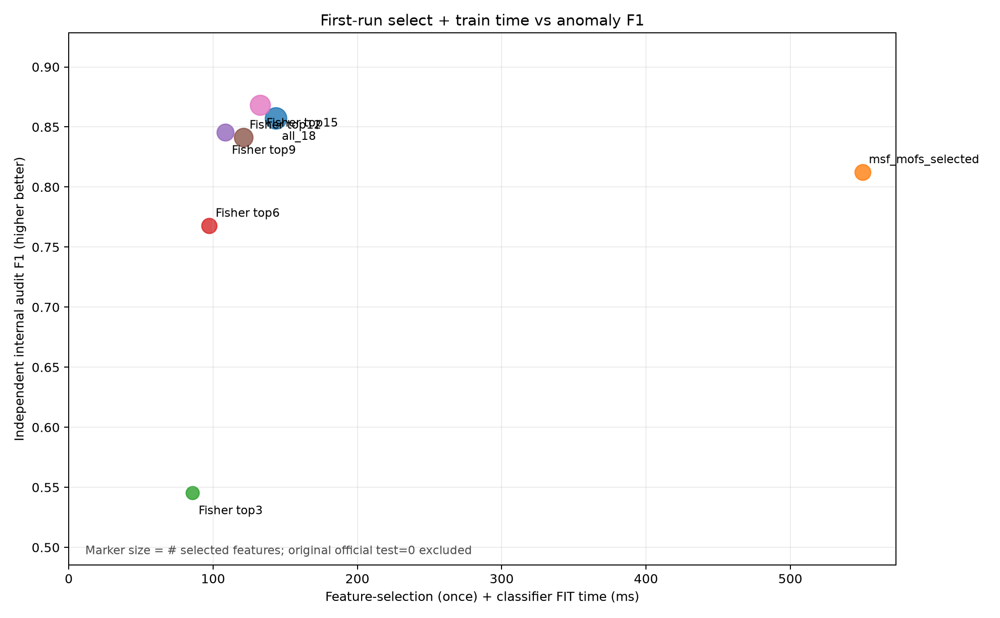

# 单一真实卫星数据集：特征数—计算成本—分类性能对照

**范围：只评价 OPS-SAT-AD，原始官方 test=0 未使用，冻结交付结果不改。**

以下是实际运行计时，单位毫秒；不同 CPU 上绝对运行时间可能不同。

| 方法 | 特征数 | 选择耗时（一次）ms | 分类器训练中位数 ms | 单片段预测中位数 ms | 内部审计 F1 | 内部审计 AP |
|---|---:|---:|---:|---:|---:|---:|
| all_18 | 18 | 0.00 | 143.29 | 0.0124 | 0.8571 | 0.9309 |
| msf_mofs_selected | 7 | 449.50 | 100.53 | 0.0120 | 0.8125 | 0.8984 |
| fisher_top3 | 3 | 0.69 | 84.92 | 0.0123 | 0.5455 | 0.6288 |
| fisher_top6 | 6 | 0.69 | 96.69 | 0.0121 | 0.7679 | 0.8534 |
| fisher_top9 | 9 | 0.69 | 107.91 | 0.0124 | 0.8455 | 0.9307 |
| fisher_top12 | 12 | 0.69 | 120.20 | 0.0123 | 0.8413 | 0.9275 |
| fisher_top15 | 15 | 0.69 | 131.89 | 0.0122 | 0.8682 | 0.9266 |

MSF 相比完整特征，特征数从 18 减为 7；
其训练时间是 100.53ms vs 143.29ms； 审计 F1 是 0.8125 vs 0.8571。

## 图表

第一张图检验“选少量特征后，下游模型是否训练更快”；第二张图检验“把特征搜索过程也算进去后，第一次训练总时间是否仍占优”。
每个点表示一种方法；面积表示特征数。建议在论文中同时报告 AP/Recall、模型大小和预测耗时，不只给 F1。

## 必要解释

- 没有测量官方 18 项统计特征从原始卫星遥测提取的时间，不能因此宣称完整在线推理延迟改善。
- 18 维是低维情况，MSF 搜索自身可能远比一次模型训练耗时；在这一数据集上不应预设 MSF 是最优。
- 计时来自 GitHub Actions 同一次固定环境的 7 次重复；用 median + 四分位数区间降低时钟噪声。
- 这张图表达的是单数据集内的成本—效果权衡，不涉及跨数据集迁移，也不构成专利创造性证明。
