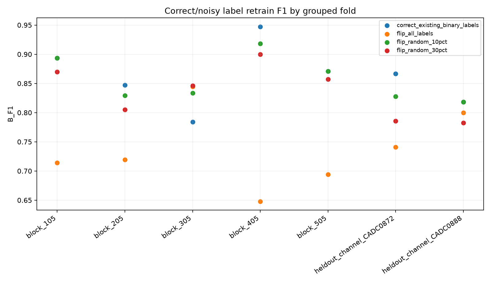
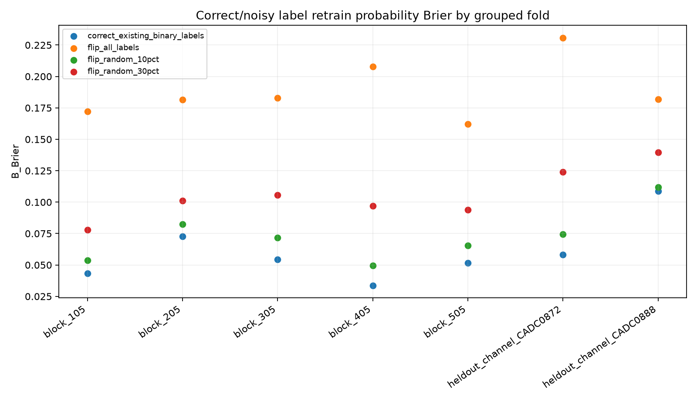

# OPS-SAT 单真实数据集：按通道与相邻片段分组的监督更新稳定性

**本研究只实现非保密普通基线及它们的真实OPS-SAT结果。任何待专利的私有候选规则均未提交本仓库。**

固定的原真实OPS-SAT数据，2,578维输入，MSF预算上限64。共完成 7 组，预设分组不可执行 1 组。
每组从原官方训练样本中分离旧训练、模拟新增标签、阈值/参考校准、独立验收、审计；原529条官方测试始终不用。
每个通道先按segment ID排序，再以16个相邻ID条目为一组。此排序只是近邻代理，不保证卫星实际UTC时间。
额外留出整个目标通道，评价合法新通道/工况上的旧模型置信冲突，不能将冲突自动定性为假标签。

| 标签条件 | 完成组数 | 普通门控C接受 | 严格Brier/NLL门控D接受 | E非0混合次数 | 平均B-A F1 | 平均B-A Brier | B F1改善次数 |
|---|---:|---:|---:|---:|---:|---:|---:|
| correct_existing_binary_labels | 7 | 6 | 1 | 4 | +0.0351 | -0.00181 | 5 |
| flip_all_labels | 7 | 0 | 0 | 0 | -0.0889 | +0.12626 | 2 |
| flip_random_10pct | 7 | 5 | 1 | 0 | +0.0298 | +0.01062 | 4 |
| flip_random_30pct | 7 | 3 | 0 | 0 | +0.0091 | +0.04343 | 3 |

研究结论以实际分组与稀疏故障类别限制为边界；小通道或异常数不足的预冻结分组如实记为infeasible，不得事后挑选表现良好的随机种子。
正确标签更新被拒绝并不等于适应成功；错误标签有时被允许同样不能省略。
本项目以一个真实卫星数据集为目标，不涉及跨数据集迁移或真实三级物理状态验证。
