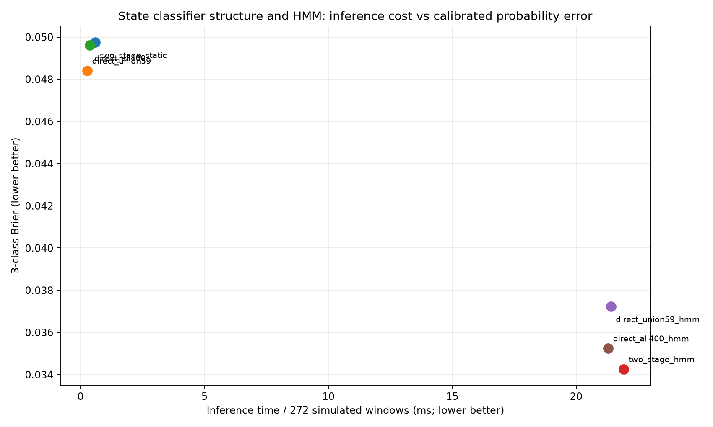
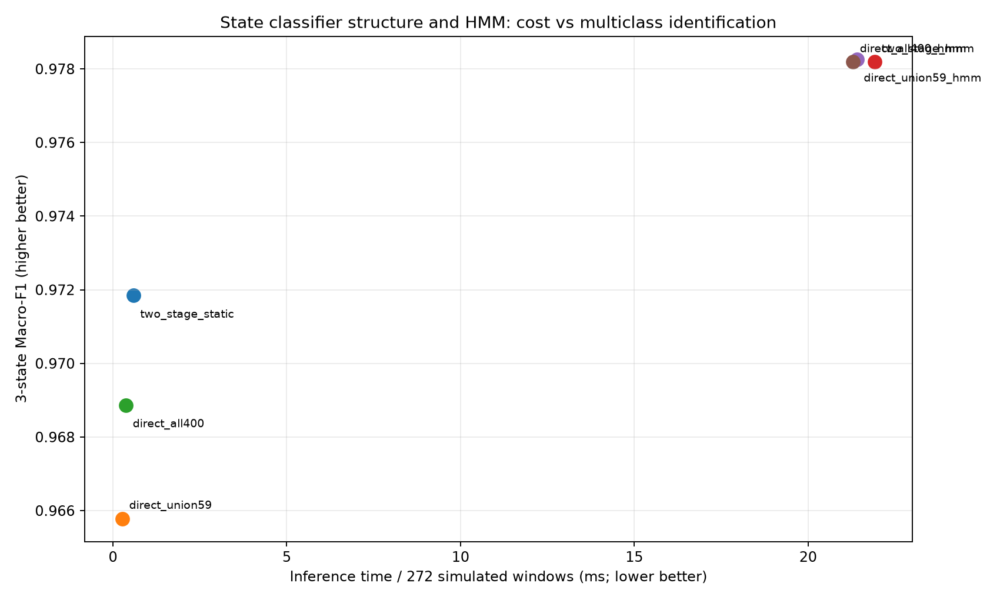
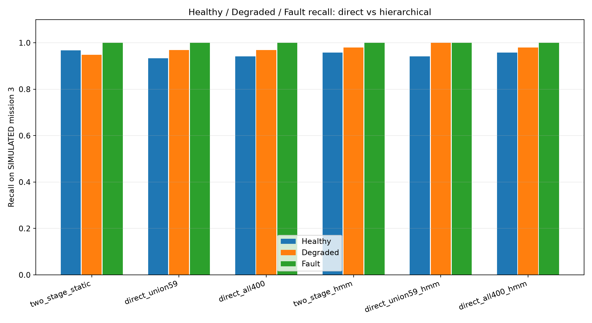

# 两级健康状态分类 vs 直接三级分类：模拟数据多目标消融

**声明：此项研究使用同一冻结的全模拟卫星数据。测试任务 272 个窗口来自模拟 mission3，绝非真实物理卫星故障标签。**

直接分类器在模拟 missions0,1 拟合，在 mission2 通过温度缩放进行概率校准。两级分类器来自冻结 MVP，不重新选特征。三个静态模型均接入相同的已经训练好的 HMM 转移矩阵和先验，单独比较 HMM 增益。

| 方法 | 特征数 | Macro-F1 | Brier ↓ | NLL ↓ | 健康召回 | 退化召回 | 故障召回 | 272窗推断ms |
|---|---:|---:|---:|---:|---:|---:|---:|---:|
| 两级静态 | 59 | 0.9718 | 0.0498 | 0.0794 | 0.9667 | 0.9479 | 1.0000 | 0.586 |
| 直接三分类（59维） | 59 | 0.9658 | 0.0484 | 0.0838 | 0.9333 | 0.9688 | 1.0000 | 0.268 |
| 直接三分类（400维） | 400 | 0.9689 | 0.0496 | 0.0744 | 0.9417 | 0.9688 | 1.0000 | 0.371 |
| 两级 + HMM | 59 | 0.9782 | 0.0343 | 0.0626 | 0.9583 | 0.9792 | 1.0000 | 21.914 |
| 直接59维 + HMM | 59 | 0.9783 | 0.0372 | 0.0615 | 0.9417 | 1.0000 | 1.0000 | 21.402 |
| 直接400维 + HMM | 400 | 0.9782 | 0.0353 | 0.0634 | 0.9583 | 0.9792 | 1.0000 | 21.290 |

## 模型拟合/校准代价

| 模型 | 中位拟合+概率校准时间 (ms) |
|---|---:|
| two_stage_retrain_without_feature_search | 6.99 |
| direct_union59_train_and_calibrate | 7.60 |
| direct_all400_train_and_calibrate | 16.14 |

训练计时不包括事先完成的特征选择搜索；推断计时不包含原始遥测特征生成。

结论应结合各类别召回、概率 Brier/NLL、训练与推断成本，不以单一 Macro-F1 判定层级结构必然更优。本研究先前已经见过相同模拟任务的测试结果，因而属于事后探索性消融。