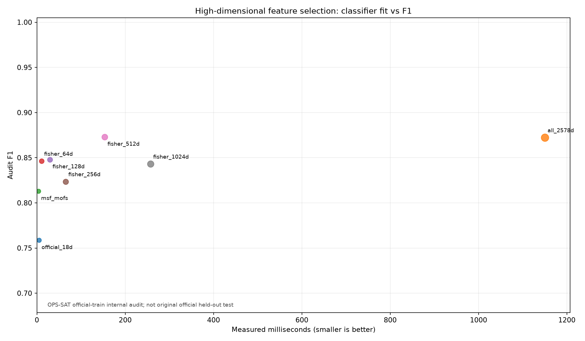
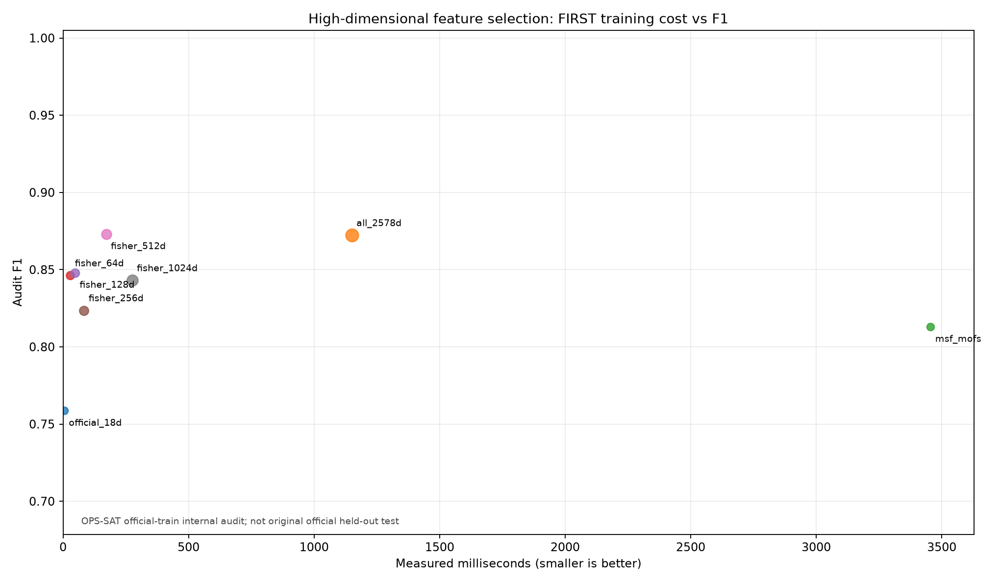
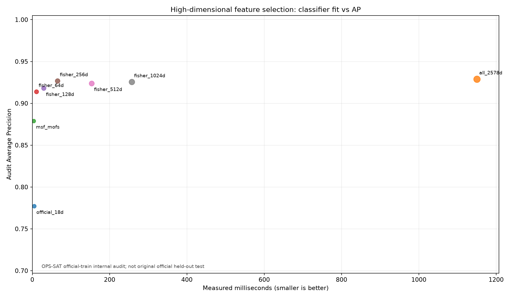

# OPS-SAT 真实卫星原始遥测：2578 维特征成本—性能对照

**注意：本实验使用真实单通道原始遥测片段生成 2560 项派生特征，并附加官方 18 项摘要特征；没有生成随机假特征。插值不增加独立信息，且全部为片段结束后的回顾性统计。**

样本数：训练 956、阈值校准 319、内部审计 319；此前官方测试 529 条不使用。
真实原始点数 303493，9 个通道，派生特征提取总耗时 7.13 秒。
一次性 MSF-MOFS 搜索耗时 3452.1 ms，选出 13 / 2578 维；同一逻辑回归分类器重复训练 5 次取中位数。

| 方案 | 特征数 | 搜索时间 ms | 分类器训练 ms | 首次总成本 ms | F1 | AP | Recall | 正常误报率 |
|---|---:|---:|---:|---:|---:|---:|---:|---:|
| official_18d | 18 | 0.0 | 4.5 | 4.5 | 0.7586 | 0.7771 | 0.6875 | 0.0314 |
| all_2578d | 2578 | 0.0 | 1150.2 | 1150.2 | 0.8722 | 0.9289 | 0.9062 | 0.0431 |
| msf_mofs | 13 | 3452.1 | 3.4 | 3455.5 | 0.8130 | 0.8790 | 0.7812 | 0.0353 |
| fisher_64d | 64 | 18.3 | 10.4 | 28.7 | 0.8462 | 0.9139 | 0.8594 | 0.0431 |
| fisher_128d | 128 | 18.3 | 29.3 | 47.6 | 0.8480 | 0.9180 | 0.8281 | 0.0314 |
| fisher_256d | 256 | 18.3 | 65.2 | 83.6 | 0.8235 | 0.9267 | 0.7656 | 0.0235 |
| fisher_512d | 512 | 18.3 | 153.7 | 172.1 | 0.8730 | 0.9239 | 0.8594 | 0.0275 |
| fisher_1024d | 1024 | 18.3 | 257.3 | 275.7 | 0.8430 | 0.9255 | 0.7969 | 0.0235 |

MSF vs 全部2578维：特征压缩率 **99.5%**；单次分类器训练节省 **1146.8 ms**；审计 F1 变化 **-0.0592**；AP 变化 **-0.0499**。
按单次训练成本简单摊销，不计特征提取，MSF 需要约 **4** 次分类器重训才抵消一次性的特征搜索。

特征选择后下游训练更快，不代表含搜索和全量特征提取的总流程一定更快。此实验既报告成本节省，也如实报告 F1/AP/Recall 等性能变化。
