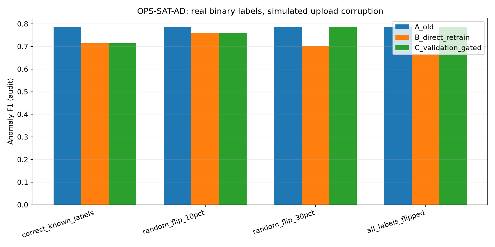
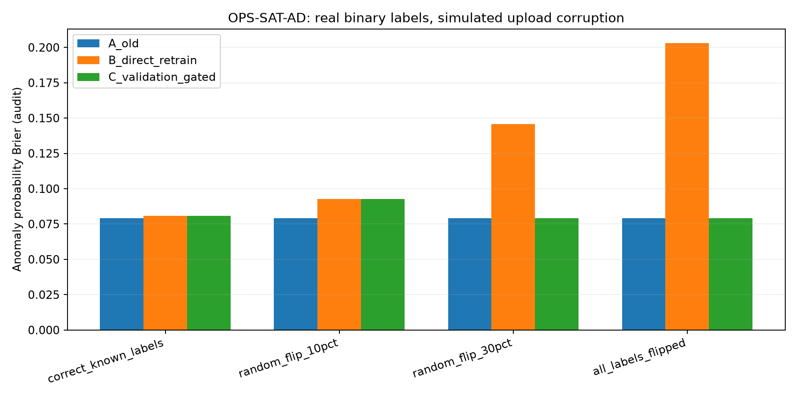
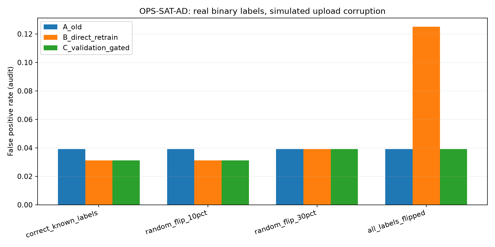

# 真实 OPS-SAT-AD：固定 MSF 最大64特征预算的有标签更新稳健性预验收

**真实来源是卫星遥测与已经存在的正常/异常二分类标签；“上传的人工审核标签”是把已有标签模拟包装。没有真实操作员重新审核。**

内部分区：历史训练 876、模拟上传 319、阈值/验收 239、内部审计 160；原始官方测试 529 全程未用于此轮。
高维2578特征，MSF固定预算上限64；本次仅由历史训练集选取 **32维**，一次性搜索耗时524.4ms。

| 模拟更新标签 | 注入反转条数 | 常规验证门控通过 | A 不更新 F1 | B 普通重训 F1 | C 暂存后 F1 | C 审计 Brier |
|---|---:|---|---:|---:|---:|---:|
| correct_known_labels | 0 | True | 0.7869 | 0.7143 | 0.7143 | 0.0807 |
| random_flip_10pct | 32 | True | 0.7869 | 0.7586 | 0.7586 | 0.0926 |
| random_flip_30pct | 96 | False | 0.7869 | 0.7018 | 0.7869 | 0.0793 |
| all_labels_flipped | 319 | False | 0.7869 | 0.6667 | 0.7869 | 0.0793 |

旧模型高置信与上传标签不一致**不能直接证明标签错误**，因为它也可能是合法的工况变化；只能用于后续人工复核。
所有模型/标签门控输出都不会自动部署，专利差异化机制仍待私有验证。
