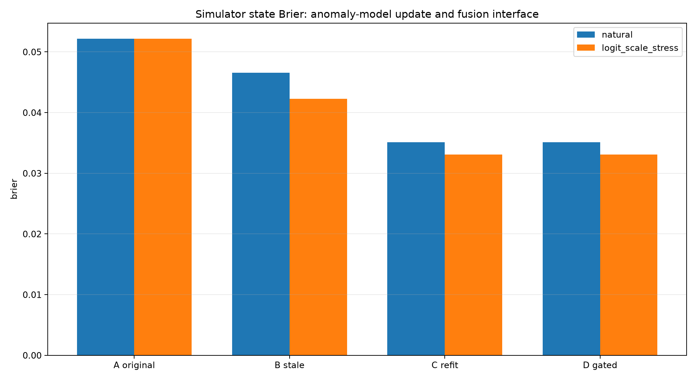
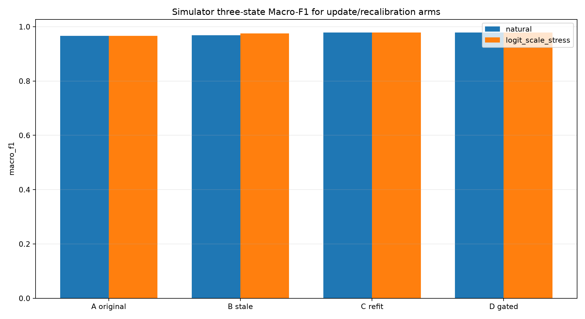
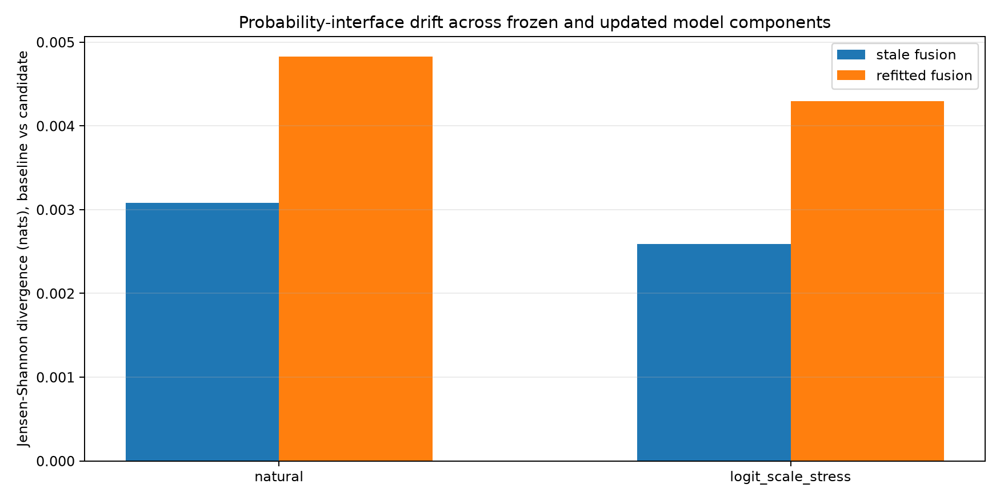

# 人工监督更新后的跨分支概率兼容性：常规工程对照基线

**重要：全部标签均来自冻结模拟器，没有真实操作员上传新标签，专利差异化算法尚未实现，模型没有发布。**

本轮固定了既有两级健康状态分类器、MSF-MOFS 特征、HMM 转移参数；仅使用模拟新增二分类标注更新异常RF，再对比是否重训普通 LogisticRegression 融合器。

数据分区：训练 missions0/1(544)；模拟新增标注 cycle8(68)；阈值校准cycle9(68)；两种融合器共同用cycle10(68)拟合；candidate验收cycle11(68)；最后mission3(272)观察。

**重大限制：**冻结健康状态分类器的Platt校准与HMM状态先验最初使用了整个mission2，其中包含cycle11。故本轮验收只证明同基线下常规分支比较的工程流程，不构成全系统独立验证。

两种场景：natural=真实发生的模拟监督RF重训；logit_scale_stress=对新RF输出进行人为固定logit缩放，用来测试接口数值变化的脆弱性，不是新卫星工况或新的有标签模型。

| 场景 | 对照 | 三级Macro-F1 ↑ | 三级Brier ↓ | NLL ↓ | 模拟健康分MAE ↓ | 异常F1 | 异常AP | 异常Recall | 正常FPR |
|---|---|---:|---:|---:|---:|---:|---:|---:|---:|
| natural | A 旧异常分支+兼容融合 | 0.9658 | 0.05215 | 0.08656 | 8.109 | 0.9799 | 1.0000 | 0.9605 | 0.0000 |
| natural | B 更新异常分支+旧融合 | 0.9689 | 0.04654 | 0.07712 | 8.035 | 0.9867 | 1.0000 | 0.9737 | 0.0000 |
| natural | C 更新异常分支+常规重新校准融合 | 0.9782 | 0.03513 | 0.06408 | 7.825 | 0.9867 | 1.0000 | 0.9737 | 0.0000 |
| natural | D 门控后的候选（不发布） | 0.9782 | 0.03513 | 0.06408 | 7.825 | 0.9867 | 1.0000 | 0.9737 | 0.0000 |
| logit_scale_stress | A 旧异常分支+兼容融合 | 0.9658 | 0.05215 | 0.08656 | 8.109 | 0.9799 | 1.0000 | 0.9605 | 0.0000 |
| logit_scale_stress | B 更新异常分支+旧融合 | 0.9751 | 0.04224 | 0.06985 | 7.957 | 0.9867 | 1.0000 | 0.9737 | 0.0000 |
| logit_scale_stress | C 更新异常分支+常规重新校准融合 | 0.9782 | 0.03309 | 0.05947 | 7.792 | 0.9867 | 1.0000 | 0.9737 | 0.0000 |
| logit_scale_stress | D 门控后的候选（不发布） | 0.9782 | 0.03309 | 0.05947 | 7.792 | 0.9867 | 1.0000 | 0.9737 | 0.0000 |

## 版本兼容和常规验收结论

- natural: 新旧异常概率平均绝对变化=0.0136，熵量化JS=0.00160；旧融合输入/输出JS=0.00308，重新拟合融合后输出JS=0.00483。验证门控通过=True；选择=C 更新异常分支+常规重新校准融合。
- logit_scale_stress: 新旧异常概率平均绝对变化=0.0300，熵量化JS=0.00649；旧融合输入/输出JS=0.00259，重新拟合融合后输出JS=0.00429。验证门控通过=True；选择=C 更新异常分支+常规重新校准融合。

更新异常检测器的概率接口不等于更新HMM状态转移概率；本次保持健康分支/HMM不变，普通融合器需要评估是否重校准。
观察正向改进不代表专利创新：普通融合重训和验证门控都是标准工程方案。
没有任何真实人工身份认证或真实卫星三级状态标签；即使候选验证通过也没有自动部署。

仅保留一个真实卫星数据集（OPS-SAT）上的二分类证据与一个固定模拟全架构的三级证据；跨数据集迁移学习属于未来方向。
