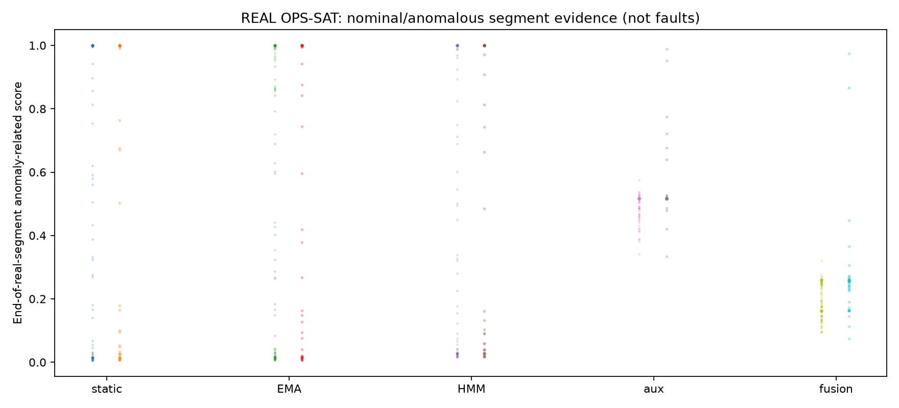

# 真实OPS-SAT：健康度主线HMM初始化和异常辅线比较

**真实遥测，无生成数据；三级运行等级仅由正常参考分布的预设分位规则初始化，非物理真值；原529条官方测试未使用。**

| 方法 | 审计AP | 审计F1 | 审计Recall | 正常误报FPR |
|---|---:|---:|---:|---:|
| static | 0.2305 | 0.3654 | 0.8837 | 0.9137 |
| EMA | 0.2192 | 0.3673 | 0.8372 | 0.8417 |
| HMM | 0.2367 | 0.3704 | 0.8140 | 0.7986 |
| aux | 0.4710 | 0.2712 | 0.1860 | 0.0576 |
| fusion | 0.4506 | 0.3838 | 0.4419 | 0.2662 |

真实训练内部阶段：{'fit': {'segments': 920, 'binary_anomalies': 195}, 'fusion_fit': {'segments': 286, 'binary_anomalies': 64}, 'calibration': {'segments': 160, 'binary_anomalies': 14}, 'audit': {'segments': 182, 'binary_anomalies': 43}}；风险等级初始阈值：{'q50': 1.1646826688784797, 'q70': 1.7301237102059117, 'q95': 9.054798776415305}。
来源哈希：dab2e01e873c93590692b50a7cc312d9cce4d5ba7e69ce8015603c47a8ffb97b；真实时序窗口总数：27201。
真实监督目标仅是整段正常/异常；HMM是弱定义运行风险状态的因果滤波，不是设备真实故障状态识别。
显示健康度采用**人为初始评分政策**，没有专家评分，不能汇报评分MAE。客观异常告警始终独立于主观分数。
本次采用轻量风险特征基线验证主辅逻辑，完整MSF64/两级状态分类器的真实融合效果尚待后续对照。
