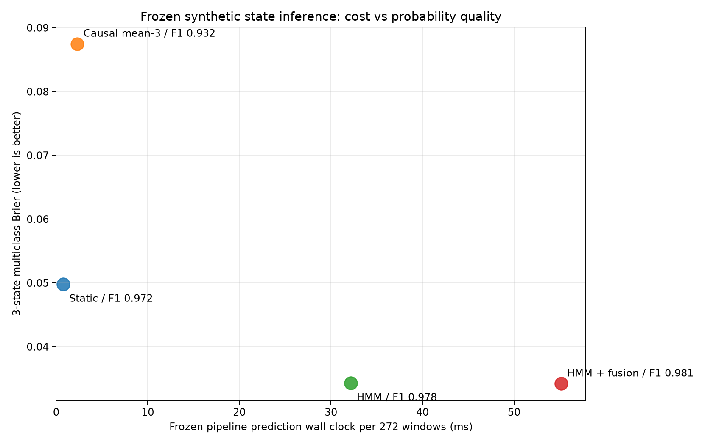
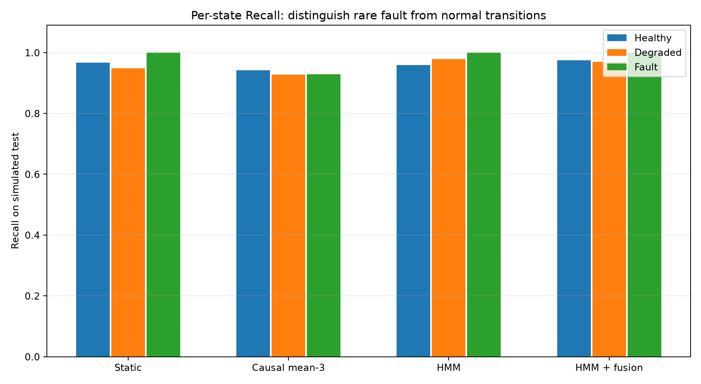
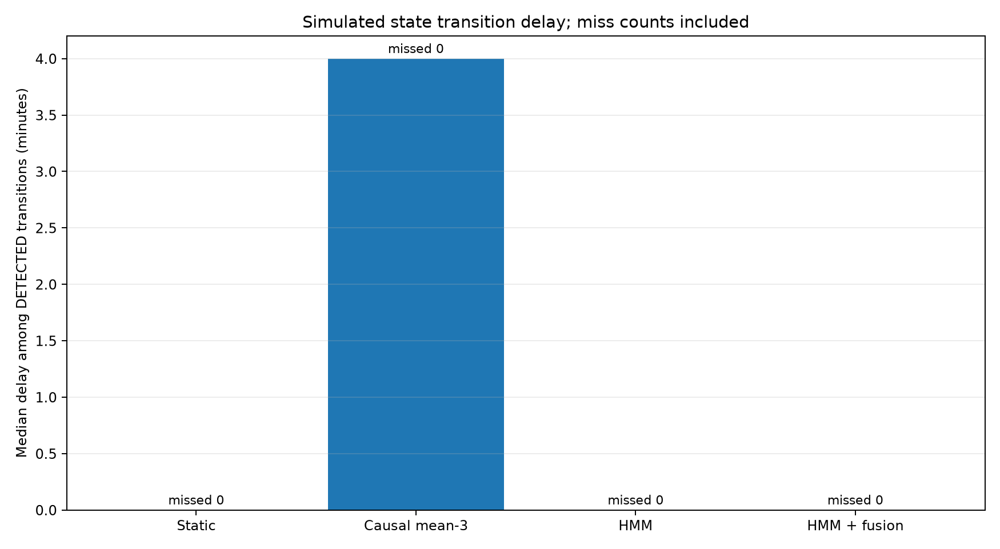

# HMM 与概率融合的目的导向评估（完全模拟数据）

**所有健康/退化/故障、异常和人工评分都是模拟真值。本实验是冻结 MVP 的多指标消融，不是 OPS-SAT 真实三级健康状态验证。**

不训练新模型，不动交付版；直接读取保存的两级分类器、HMM、异常检测器及融合模型，对测试任务段进行同一批样本的复现。
测试含 272 个窗口、4 条模拟周期，每 4 分钟一个窗口。

| 方法 | Macro-F1 | Brier ↓ | NLL ↓ | Healthy Recall | Degraded Recall | Fault Recall | 漏检切换 | 已检出切换中位延迟(min) | 272窗口推断中位(ms) |
|---|---:|---:|---:|---:|---:|---:|---:|---:|---:|
| 静态两级状态 | 0.9718 | 0.0498 | 0.0794 | 0.9667 | 0.9479 | 1.0000 | 0/12 | 0.0 | 0.758 |
| 静态+历史均值(3) | 0.9324 | 0.0875 | 0.1380 | 0.9417 | 0.9271 | 0.9286 | 0/12 | 4.0 | 2.310 |
| 静态+HMM | 0.9782 | 0.0343 | 0.0626 | 0.9583 | 0.9792 | 1.0000 | 0/12 | 0.0 | 32.151 |
| 静态+HMM+异常融合 | 0.9813 | 0.0342 | 0.0562 | 0.9750 | 0.9688 | 1.0000 | 0/12 | 0.0 | 55.122 |

模拟评分：默认健康分 MAE=7.960，使用模拟人工评分校正后 MAE=2.623。

时间延迟定义为：在同一模拟周期内，真实状态变更后直到首次输出该目标类别的时间（4分钟窗口步长）；
未检出的转移单独报告，不计为0延迟。跨周期不连边。
真实 OPS-SAT 目前没有物理三级状态标注，因此本结果不得用于宣称真实卫星故障状态识别率。
所有模型参数均来自原冻结模拟实验，未因本次测试结果调参。

64维预算固定为此前真实 OPS-SAT 2578维多尺度特征选择的工程配置，实际选中37维；
本次复现沿用冻结模拟模型的既有400维特征输入和两级选择结果，不将两个任务的特征预算强制混淆。
