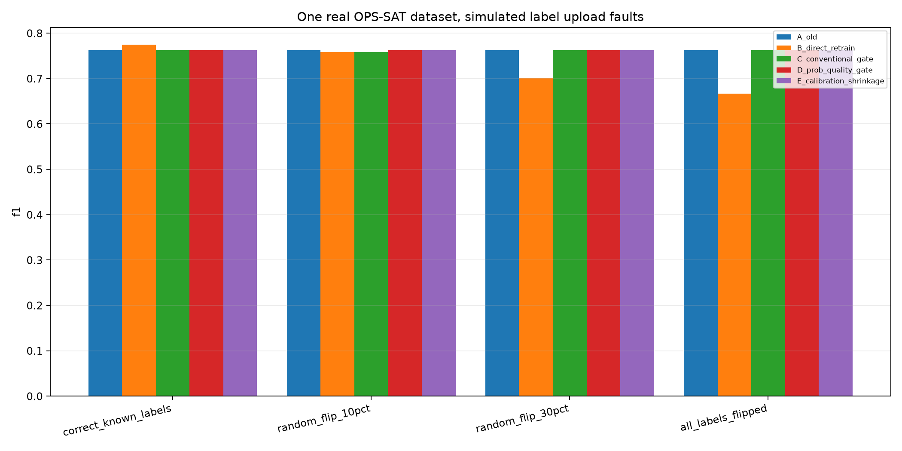
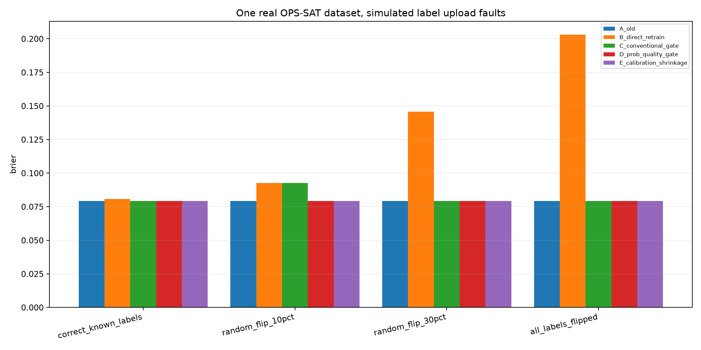

# OPS-SAT真实二分类：完全隔离阈值校准与候选验收的常规强基线

**这些都是常规标准工程方法，不包含私有专利候选机制。原始官方测试完全排除，不构成新的盲态确认实验。**

样本：旧训练876、上传模拟319、阈值校准119、独立候选验收120、内部审计160；原始官方测试529未使用。
MSF固定最大64预算，独立从旧训练学得32个特征；特征搜索504.2ms，旧模型训练5.0ms。

| 标签条件 | 普通门控C接受 | 含Brier/NLL门控D接受 | 保守概率混合E系数 | E实际更新 | 审计A F1 | 审计B F1 | 审计C F1 | 审计D F1 | 审计E F1 | 审计A Brier | 审计E Brier |
|---|---|---|---:|---|---:|---:|---:|---:|---:|---:|---:|
| correct_known_labels | False | False | 0.00 | False | 0.7619 | 0.7742 | 0.7619 | 0.7619 | 0.7619 | 0.0793 | 0.0793 |
| random_flip_10pct | True | False | 0.00 | False | 0.7619 | 0.7586 | 0.7586 | 0.7619 | 0.7619 | 0.0793 | 0.0793 |
| random_flip_30pct | False | False | 0.00 | False | 0.7619 | 0.7018 | 0.7619 | 0.7619 | 0.7619 | 0.0793 | 0.0793 |
| all_labels_flipped | False | False | 0.00 | False | 0.7619 | 0.6667 | 0.7619 | 0.7619 | 0.7619 | 0.0793 | 0.0793 |

**解读规则：** 拒绝候选后维持旧模型不是「新模型更新成功」，且过度保守导致正确更新全部拒绝，也不应视为完成受控适应。 独立验收防止把同一批样本同时用于阈值与接受判断，但小样本仍可能导致波动。
 所有真实标签均为官方原有二分类标签，新增人工审核是模拟上传，三级状态+HMM只能由既有模拟状态实验支撑。